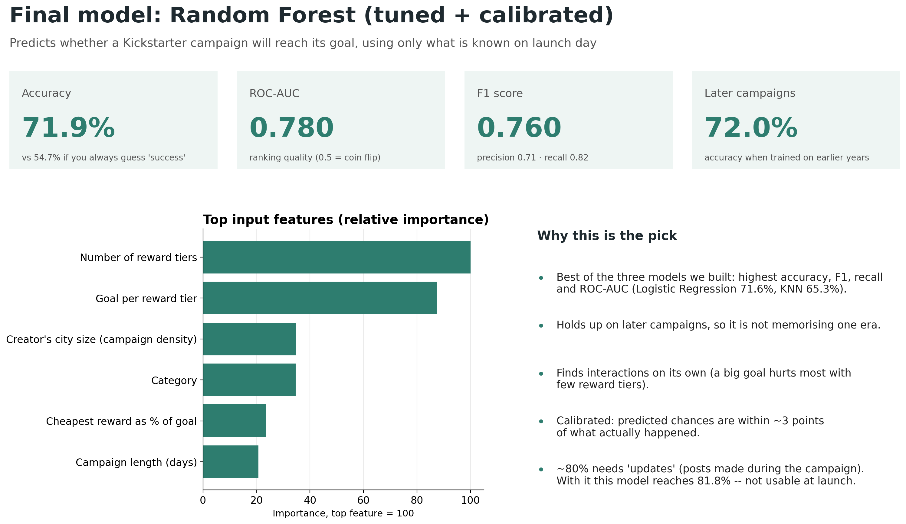
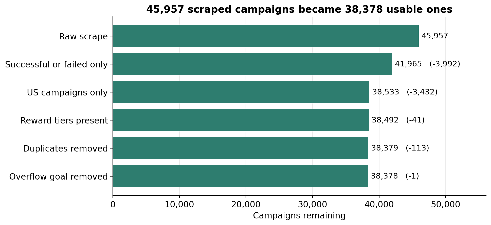
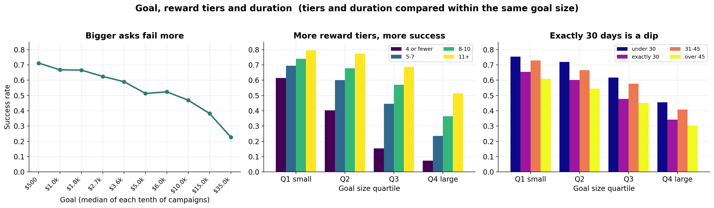
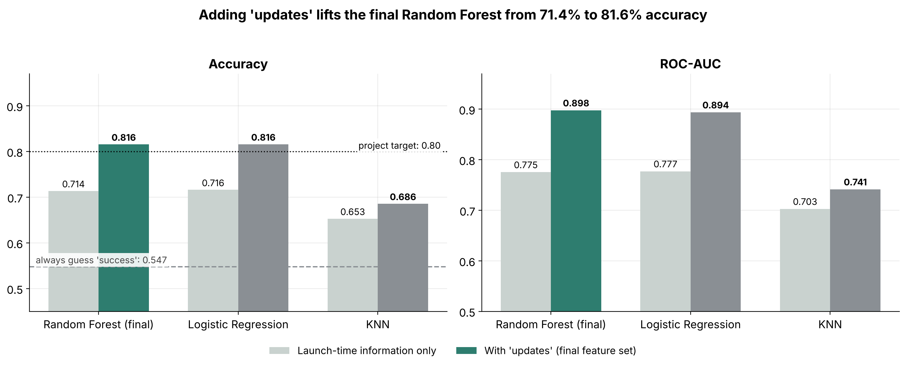
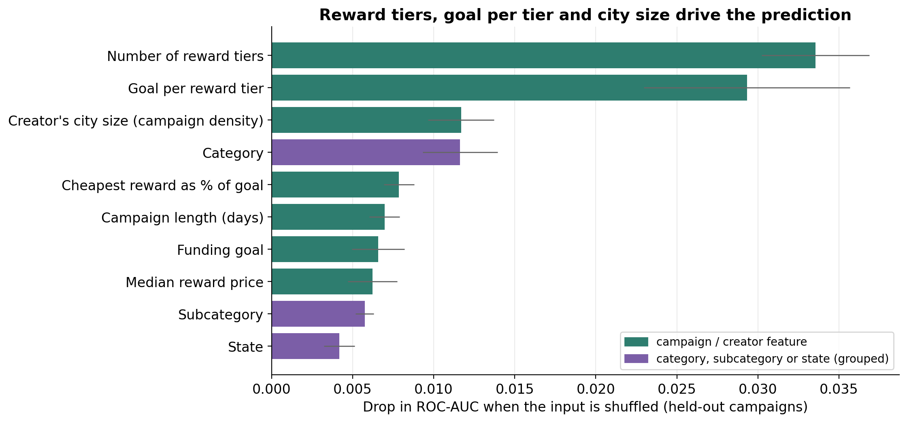
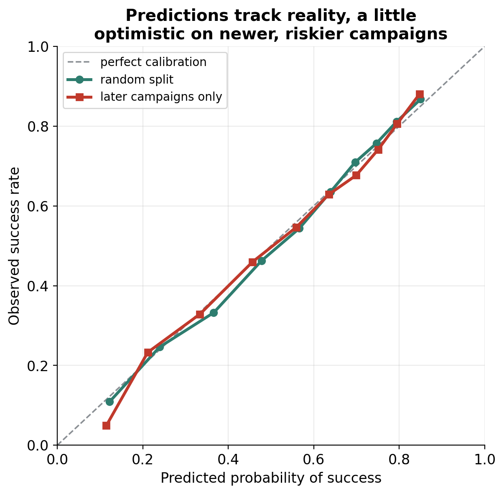
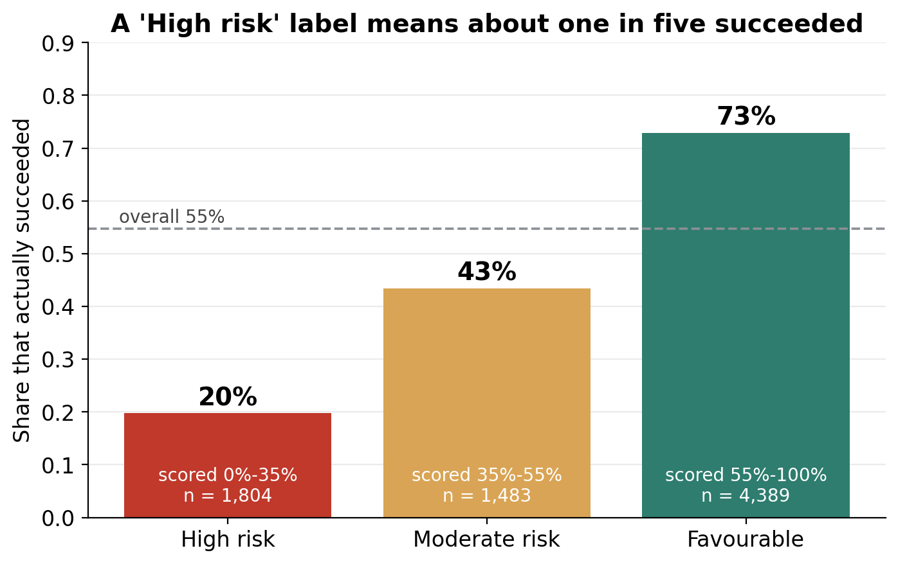
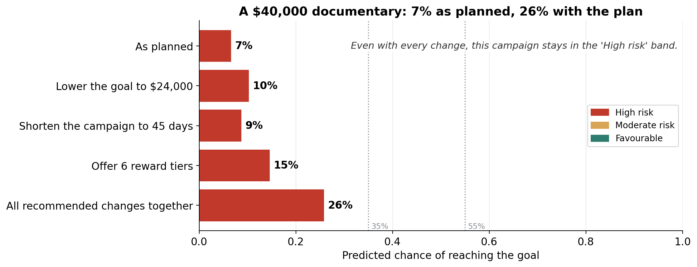
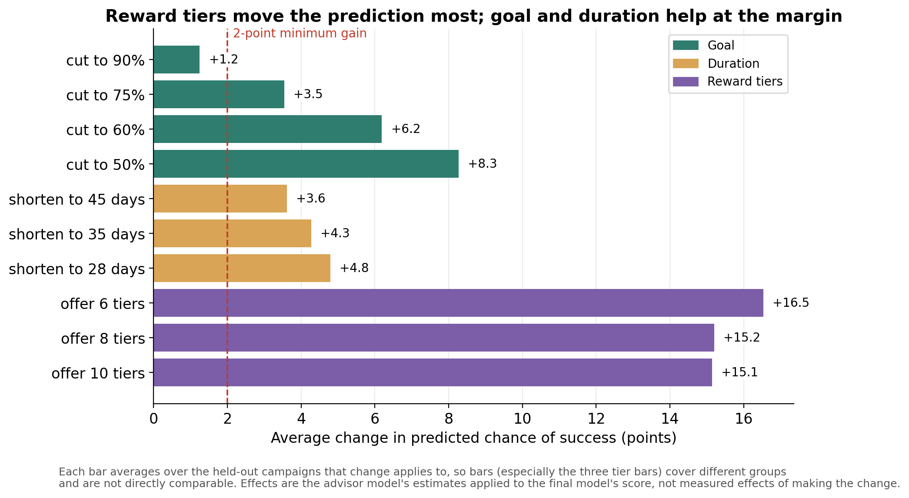

# Kickstarter Crowdfunding Recommendation Engine

Predicting whether a Kickstarter campaign will reach its goal from information
available **at launch**, and turning what the data associates with success into
advice a creator can act on before they publish.

Break Through Tech AI Studio — Fall 2026
Challenge Advisor: Neha Panchal · AI Studio Coach: Darshan Ugale

> **Status: complete.** All four milestones are done: data preparation, EDA,
> machine learning (final model: **Random Forest, tuned + calibrated, 71.9%
> accuracy at launch**) and the recommendation prototype, plus final charts.



---

## Team Members

| Name | GitHub Handle | Contribution |
|------|---------------|--------------|
| James Lu | @jameslu06 | Data exploration, visualization, Random Forest model, overall project coordination, team lead |
| Yero Barry | @Ybarry2 | Python development, Logistic Regression model and tuning, prompt engineering, team communication |
| Menwe Okafor | @menwe2310 | Python development, KNN model, AI model development and data analysis |

---

## Milestones and Tasks

### September — Milestone 1 (Data Preparation) & Milestone 2 (Exploratory Data Analysis)

| # | Task | Target | Status | Evidence |
|---|------|--------|--------|----------|
| 1 | Download and inspect the dataset | 9/9 | Done | `notebooks/01_inspection.ipynb` |
| 2 | Filter and clean the dataset | 9/13 | Done | `notebooks/02_cleaning.ipynb` |
| 3 | Prepare features for analysis | 9/17 | Done | `notebooks/03_features.ipynb` |
| 4 | Perform exploratory data analysis | 9/24 | Done | `notebooks/04_eda.ipynb` |
| 5 | Create visualizations and summarize findings | 9/30 | Done | `notebooks/04_eda.ipynb`, `reports/` |

### October — Milestone 3 (Machine Learning / Modeling)

| # | Task | Target | Status | Evidence |
|---|------|--------|--------|----------|
| 6 | Prepare data and lock the feature set | 10/7 | Done | `notebooks/05_prepare_and_split.ipynb`, `reports/m3_leakage_register.csv`, `reports/m3_split_summary.csv` |
| 7 | Build baseline and classification models | 10/14 | Done | `notebooks/06a_logistic_regression.ipynb` (Yero), `06b_random_forest.ipynb` (James), `06c_knn.ipynb` (Menwe), `reports/m3_task7_*.csv` |
| 8 | Compare model performance | 10/20 | Done | `notebooks/07_comparison.ipynb`, `reports/m3_task8_comparison.csv` |
| 9 | Perform feature selection and tune models | 10/27 | Done | `notebooks/08_tuning.ipynb`, `reports/m3_tuned_config.json` |
| 10 | Analyze interpretability and select the final model | 10/31 | Done | `notebooks/09_final_model.ipynb`, `reports/m3_model_card.json`, `reports/m3_final_feature_importance.csv` |

### November — Milestone 4 (Recommendation Prototype)

| # | Task | Target | Status | Evidence |
|---|------|--------|--------|----------|
| 11 | Define the recommendation approach and identify risk factors | 11/6 | Done | `notebooks/10_approach_and_risk_factors.ipynb`, `reports/m4_risk_bands.csv`, `reports/m4_at_risk_profile.csv` |
| 12 | Connect predictions to recommendations (rules and logic) | 11/13 | Done | `notebooks/11_recommendation_logic.ipynb`, `src/recommend.py`, `reports/m4_lever_effects.csv` |
| 13 | Build the initial recommendation prototype | 11/18 | Done | `notebooks/12_prototype.ipynb`, `src/recommend.py` |
| 14 | Test the prototype on sample campaigns and improve it | 11/24 | Done | `notebooks/13_test_and_improve.ipynb`, `reports/m4_sample_assessments.csv`, `reports/m4_edge_cases.csv` |
| 15 | Final validation of the model and the recommendations | 11/30 | Done | `notebooks/14_validation.ipynb`, `reports/m4_validation_summary.json` |

### December — Wrap-up

| # | Task | Target | Status | Evidence |
|---|------|--------|--------|----------|
| 16 | Summarize results and key insights | 12/1 | Done | This README: [Results](#results--key-findings), [Limitations](#limitations) |
| 17 | Finalize documentation and repository | 12/1 | Done | `README.md`, `requirements.txt`, `src/` docstrings |
| 18 | Create final charts and visuals | 12/1 | Done | `notebooks/15_final_charts.ipynb`, `reports/figures/final_00` … `final_08` |

---

## Project Highlights

- Cleaned a 45,957-campaign scrape into a **38,378-row** modelling table with
  every step logged, after reproducing the original project's recipe to within
  one row.
- Built **Logistic Regression, Random Forest and KNN** on identical data and
  selected a **tuned, calibrated Random Forest**: **71.9% accuracy, F1 0.760,
  ROC-AUC 0.780** from launch-day information, against a 54.7% "always guess
  success" floor. It holds at **72.0%** on later campaigns.
- Showed that the published **~80% benchmark depends on `updates`**, a variable
  posted *during* the campaign. With it, the same Random Forest reaches 81.8%,
  but that is a mid-campaign number, not a launch-day prediction.
- Built a **recommendation prototype**: the Random Forest scores a campaign
  and a Logistic Regression "advisor" estimates what changing the goal, length
  or reward tiers is worth. **15 of 16** pre-stated validation checks pass; the
  one failure is reported below.
- Re-tested our own September findings and **corrected four claims** that did
  not hold.

---

## Setup and Installation

```bash
git clone https://github.com/Break-Through-Tech/Global-Financial-Firm-1B-kickstarter-crowdfunding-recommendation-engine.git
cd Global-Financial-Firm-1B-kickstarter-crowdfunding-recommendation-engine

python -m venv .venv
source .venv/bin/activate        # Windows: .venv\Scripts\activate
pip install -r requirements.txt

jupyter lab
```

The raw dataset zip is committed to `data/`, so no Kaggle login is needed. The
train/test splits are not committed; notebooks rebuild them automatically
(about 40 seconds) when they are missing. Run the notebooks **in order**:
`02` writes the cleaned table `03` reads, `03` writes the files `04` reads,
`06a`–`06c` write the per-model results `07` and `09` read, `08` writes the
tuned configuration `09` reads, and `15` reads the model card and feature
importance written by `09`. The `06` notebooks also run on Google Colab (they
clone the repo automatically).

On a laptop the full run takes about 25 minutes; `08_tuning` (about 6 minutes)
and `14_validation` (about 3) are the slowest.

### Try the prototype

```python
import sys; sys.path.insert(0, "..")          # from inside notebooks/
from src.recommend import get_recommender

rec = get_recommender("..")
print(rec.report(dict(
    goal=40000, duration=60, reward_tiers=[10, 25, 50],
    category="Film & Video", subcategory="Documentary", state="CA",
)))
```

`notebooks/12_prototype.ipynb` walks through this with an editable example.

### Repository layout

```
src/loading.py       Raw load: encoding handling, column normalisation
src/cleaning.py      Filter, clean and validate, with an auditable step log
src/features.py      Feature engineering and the leakage register
src/modeling.py      Splits, the three base models, and make_final_model()
src/evaluation.py    One metric harness used by every model
src/prepare.py       Builds or loads the train/test splits (single definition)
src/recommend.py     The recommendation engine (RF scorer + LR advisor)

notebooks/01-04      Milestones 1-2: data preparation and EDA
notebooks/05-09      Milestone 3: machine learning
notebooks/10-14      Milestone 4: recommendation prototype
notebooks/15         Final charts

data/                Raw zip (committed); derived parquet (gitignored)
reports/             Result tables, model card, validation summary
reports/figures/     Charts, including final_00 ... final_08
```

---

## Project Overview

Kickstarter is all-or-nothing: a campaign that raises 99% of its goal returns
every dollar and the creator gets nothing. About **45% of resolved campaigns in
this dataset failed**. A creator makes several irreversible decisions — how much
to ask for, how long to run, how to structure rewards — before any feedback
exists. So a model that informs those decisions has to use only what is known
**at launch**.

---

## Data Exploration

**Source:** [Kickstarter dataset on Kaggle](https://www.kaggle.com/parienza/kickstarter)
**Raw size:** 45,957 campaigns × 17 columns
**Final table:** 38,378 US campaigns — 13 categories, 49 subcategories, 51
states, 3,153 cities, launched April 2009 to May 2012, 54.7% successful



### Data quality issues found and fixed

| Issue | Resolution |
|---|---|
| File is neither UTF-8 nor cp1252 | Load with `latin-1` |
| `Film &amp; Video` and `Film & Video` are separate categories | `html.unescape()` before grouping: 14 to 13 categories, 51 to 49 subcategories |
| Montana appears as both `MT` and `Mt` | Case-insensitive state whitelist |
| 142 duplicated `project_id` values | Deduplicate on the platform's own key |
| Largest goal is $21,474,836.47 = 2³¹−1 cents | Integer overflow; row dropped |
| `funded_date` is the campaign **end** date | Recovered `launch_date = funded_date − duration` |
| `reward_levels` has commas inside amounts (`$1,000`) | Comma-aware parser; 100% agreement with the scraper's own `levels` column |

**Validation.** Running the original project's recipe unchanged gives 38,492
rows against their published 38,491. Our three deliberate deviations cost 114
rows, the main one being deduplication (113 duplicate scrapes that could land
in both train and test).

### What separates successful from failed campaigns



- **Goal** — success falls steadily from 71% in the smallest tenth of goals to
  23% in the largest.
- **Reward tiers** — the strongest pattern. Within the same goal size, success
  rises with the number of tiers; for large goals it goes from about 7% with
  four or fewer tiers to about 52% with eleven or more.
- **Duration** — campaigns over 45 days do worst, and campaigns left at exactly
  30 days (the platform default) do worse than those just under or over it, in
  every goal quartile.
- **Location** — success runs from 65% in New York to 37% in Florida across the
  32 states with 150+ campaigns, a gap that survives removing goal size. The
  smallest quarter of cities succeeds 43% of the time against 62% for the largest.
- **Category** matters beyond goal size: the category ranking is nearly the same
  in every goal quartile.

### What we got wrong and fixed

While building the recommender we re-tested each September claim it would lean
on. Four did not hold, and `04_eda.ipynb` now carries the corrections:

| Earlier claim | What the data shows |
|---|---|
| "The 30-day default outperforms" | False. 30-day campaigns succeed **52.9%** of the time against 55.5% for the rest, and clearly less than 26–29 day campaigns |
| "A low entry price helps" | Mostly a tier-count effect. High-entry campaigns offer a median of 3 tiers against 8; with goal and tier count held fixed, the −23-point gap shrinks to a few points |
| "Creators can just add a $5 tier" | Not supported. Adding a $10 tier to a campaign with a >$25 entry moves the prediction by about 0.1 point |
| "Location is a modest signal" | False. A ~27-point spread across states and ~19 points across city-size quartiles |

---

## Model Development

**Prediction point: campaign launch.** `src/features.py` keeps an explicit
leakage register, and `build_model_matrix()` raises if a leaky column is
requested.

| Excluded | Why |
|---|---|
| `pledged`, `backers`, `comments`, `funded_percentage` | Outcomes; `funded_percentage` mechanically determines the target |
| `updates` | Posted *during* a campaign, so zero on launch day; causation runs at least partly backwards (a campaign funding well gets a creator who keeps posting) |

- **Feature sets:** `launch_only` (primary; 22 numeric features plus category,
  subcategory and state, 137 columns after one-hot encoding) and
  `plus_campaign` (adds `updates`, used only to measure what excluding it costs).
- **Splits:** stratified random 80/20 (30,702 train / 7,676 test) and
  chronological (train on earlier campaigns, test on the latest 20%, cut at
  2012-02-11).
- **No test information in training:** city frequency and goal-vs-subcategory
  median are fitted on the training half only.
- **One harness:** every model reports through `src/evaluation.evaluate()`, so
  three people's results stack into one table.

**Tuning, pruning and balancing** (notebook 08) each moved results by well under
a point: `class_weight="balanced"` traded recall for precision with no accuracy
gain; pruning to the 40 features with positive permutation importance cost
0.002 ROC-AUC; a randomized search settled on 300 trees, `min_samples_leaf=5`,
`max_features="sqrt"`. The binding constraint is the information in the data,
not the algorithm or its settings.

---

## Results & Key Findings

### Model comparison



| Model (launch-time features, random split) | Accuracy | Precision | Recall | F1 | ROC-AUC |
|---|---|---|---|---|---|
| **Random Forest, tuned + calibrated (final)** | **0.719** | 0.712 | 0.816 | 0.760 | **0.780** |
| Random Forest, default | 0.715 | 0.704 | **0.828** | **0.761** | 0.780 |
| Logistic Regression | 0.716 | **0.718** | 0.794 | 0.754 | 0.777 |
| KNN | 0.653 | 0.645 | 0.812 | 0.719 | 0.703 |
| Always guess "successful" | 0.547 | 0.547 | 1.000 | 0.707 | 0.500 |

**What excluding `updates` costs** (random split, accuracy): Random Forest
71.5% → 81.8%, Logistic Regression 71.6% → 81.6%, KNN 65.3% → 68.6%. The
published 80.2% benchmark is reproduced once `updates` is allowed in, which
confirms the gap is that one variable, not the modelling.

### The final model: Random Forest (tuned + calibrated)

| | Value |
|---|---|
| Accuracy | **71.9%** (floor 54.7%) |
| Precision / Recall / F1 | 0.712 / 0.816 / 0.760 |
| ROC-AUC | 0.780 |
| Later campaigns (chronological split) | 72.0% accuracy, ROC-AUC 0.790 |
| Calibration | Every decile within 3.4 points of reality (6.3 before calibration) |
| Built by | `src/modeling.make_final_model()` |

**Why it is the pick**

1. **Best on the metrics the brief asks for.** On the main test it leads
   Logistic Regression on accuracy, recall, F1 and ROC-AUC; Logistic Regression
   is ahead only on precision. The margins are small (tenths of a point to about
   2 points) and KNN is about 6 points behind both.
2. **Holds up on later campaigns** (72.0%), so it is not memorising one era.
   Logistic Regression edges it on ROC-AUC there (0.794 vs 0.790).
3. **Finds interactions on its own** — a big goal hurts most when there are few
   reward tiers — without them being hand-built.
4. **Its weak spot is fixed.** Raw forest probabilities were squeezed towards the
   middle; sigmoid calibration brings every decile within 3.4 points, so a
   probability can be shown to a creator.
5. **It is still explainable** through permutation importance (below), and the
   two model families agree on the main drivers.

An earlier draft chose Logistic Regression for readability. The team revisited
that decision: the forest is ahead where it counts, and Logistic Regression
stays in the project as the *advisor* that estimates what-if effects.

**A note on gradient boosting.** In a side check outside the pipeline, LightGBM
scored about one point higher (72.9% accuracy, ROC-AUC 0.790). It is listed under
next steps rather than adopted; it would need its own tuning and calibration
pass.

### Top input features



Permutation importance on held-out campaigns (how much ROC-AUC drops when an
input is shuffled; category, subcategory and state each shuffled as one input):

| Rank | Input | What it means for a creator |
|---|---|---|
| 1 | **Number of reward tiers** | More tiers, more success, within every goal size |
| 2 | **Goal per reward tier** | A big ask spread over few rewards is the clearest risk signal |
| 3 | **Creator's city size** | Campaigns from large creative hubs succeed more often (not changeable) |
| 4 | **Category** | Some categories succeed more at the same goal size (not changeable) |
| 5 | **Cheapest reward as % of goal** | How the entry price relates to the ask |
| 6 | **Campaign length** | Longer is worse; over 45 days is worst |

The Logistic Regression coefficients agree on the top tier (goal per tier, city
size, campaign length).

### Can the probability be trusted?



On the random split every decile is within 3.4 points, and the risk bands
separate cleanly — about one High-risk campaign in five succeeded, against
about three in four Favourable ones:



---

## Recommendation Prototype

`src/recommend.py` wraps the final model. A campaign description goes in; out
come a probability, a risk band, the campaign's position among comparable
campaigns, ranked what-if changes and a combined plan.



**Two models, two jobs**

- The **Random Forest scores** the campaign: the chance and risk band shown to a
  creator come from the final model.
- The **Logistic Regression advises**: for each change it estimates how many
  points the change is worth, and that is added to the forest's score. A forest
  is a sum of step functions — asked directly, it said cutting the goal made
  success *less* likely for 11–19% of campaigns. The advisor responds smoothly
  and always in the same direction. Re-scoring each finished plan with the
  forest itself confirms it helps in all 250 replayed cases.

**How it works**

1. Score the campaign and place it in a risk band, with the share of held-out
   campaigns scored near that probability that actually succeeded.
2. Compare its goal, duration and tiers with campaigns in the same subcategory.
3. Change **one lever at a time** — goal, duration, number of reward tiers —
   rebuilding every derived feature from raw inputs.
4. Recommend the **mildest** change per lever that adds at least 2 points.
5. Estimate the combined plan; the effects are not simply additive.
6. State the trade-offs and the limits.



**Design commitments, enforced in code**

- **Launch-time information only.** `updates`, `backers`, `pledged`, `comments`
  and `funded_percentage` have no input slot, and offering one raises an error.
- **Only changeable factors are advised.** Category and location inform the
  prediction but are never recommended.
- **Never advise from or to exactly 30 days.** A one-day move across the default
  shifts the prediction by about 5.5 points — that is the "left at default"
  flag, not the length.
- **No entry-price lever**, for the reason in the corrections table.
- **A lower goal shows what it gives up**, including goal × probability.

**Replayed on 250 held-out at-risk campaigns:** all but one received advice;
the median plan adds about 14 points; 42% of plans reach 50% or better. In
**about 3 plans in 10, goal × probability falls**: a lower goal reduces what a
successful campaign raises by more than the better odds make up for.

### Validation — 15 of 16 checks pass

Every check in `14_validation.ipynb` states its pass condition before the
result is shown.

| Question | Answer |
|---|---|
| Launch-time information only? | **Yes** — no post-launch column among the 137 features; all 7 post-launch fields refused |
| Same model as Milestone 3? | **Yes** — matches the model card to four decimals |
| Holds on later campaigns? | **Yes on accuracy** (71.9% vs 72.0%) |
| Calibrated? | Yes on the random split (3.4 points). **FAIL on the chronological split: 6.5 points in the lowest decile** against a 5-point limit — the later, riskiest campaigns did worse than predicted |
| Fair across city size? | Calibrated in every group (within 4.4 points), **but** small-city creators are scored High risk ~1.9× as often as large hubs (29% vs 16%) |
| Levers move the right way? | Yes — 99.8%+ of eligible campaigns for every change |
| Evidence stable over time? | Yes — tier gradient, 30-day dip and long-campaign penalty hold in both periods |
| Plans sensible? | No plan lowers a chance; ~3 in 10 lower goal × probability |

---

## Limitations

- **Launch-time ceiling (~72%).** Tuning, pruning, balancing and three model
  families all land within about a point of each other. The scrape has no
  description, video, images, creator history or social following.
- **Associations, not causes.** No campaign in the data changed one thing and
  was observed again. Reward tiers is the strongest pattern and the one most
  plausibly driven by creators who plan carefully.
- **The forest cannot extrapolate.** Its scores bottom out around 6%, so for
  extreme goals the report quotes the Logistic Regression's lower figure and
  treats the forest's as an upper bound.
- **2009–2012, US only.** The calibration slip on later data suggests the model
  was already ageing inside that window.
- **The city feature** is a documented fairness trade-off: dropping it costs
  ~0.4 points of accuracy and narrows (does not close) the High-risk gap.
- **Nobody outside the team has used the prototype.**

## Next Steps

- Add signal the scrape lacks: campaign text, video and image counts, creator
  history and following.
- Try gradient boosting (LightGBM) with its own tuning and calibration.
- Test the prototype with real creators.
- Decide whether to drop the city-density feature.
- Retrain on recent data and re-check calibration.

---

## License

This project is licensed under the MIT License.

## References

- [Kickstarter dataset on Kaggle](https://www.kaggle.com/parienza/kickstarter)
- [scikit-learn documentation](https://scikit-learn.org/stable/)

## Acknowledgements

Thanks to Challenge Advisor Neha Panchal and AI Studio Coach Darshan Ugale for
guidance throughout this project.