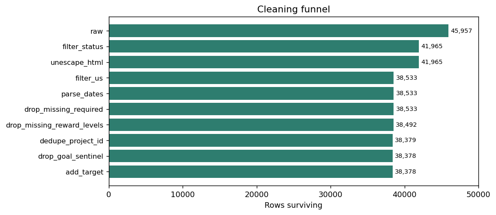
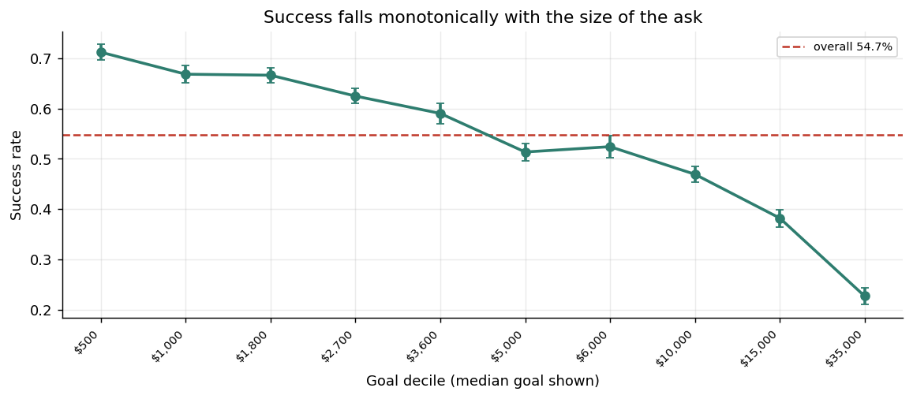
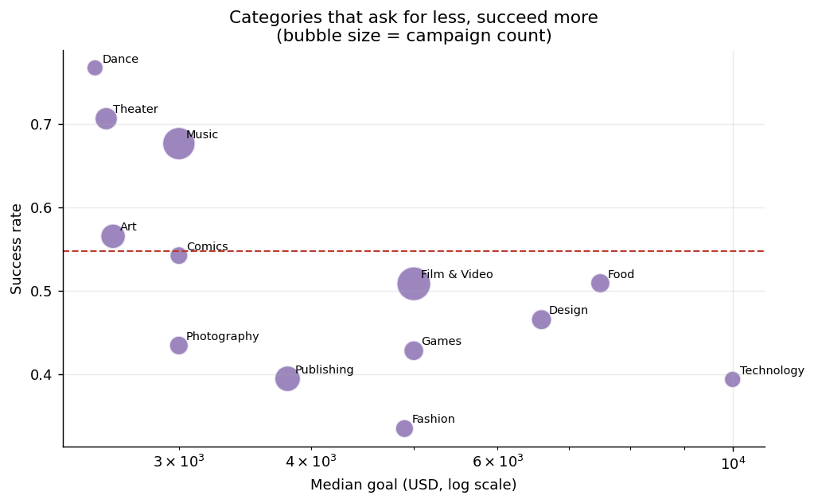
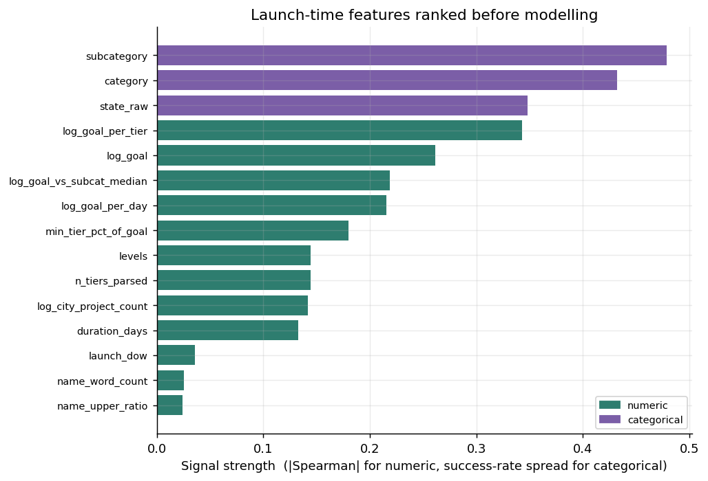
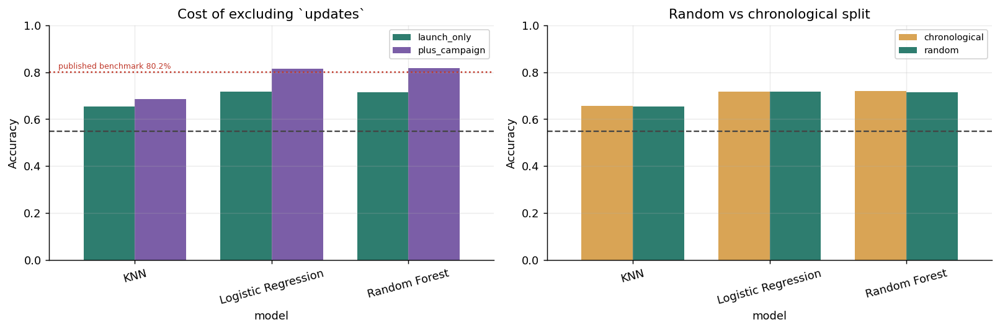
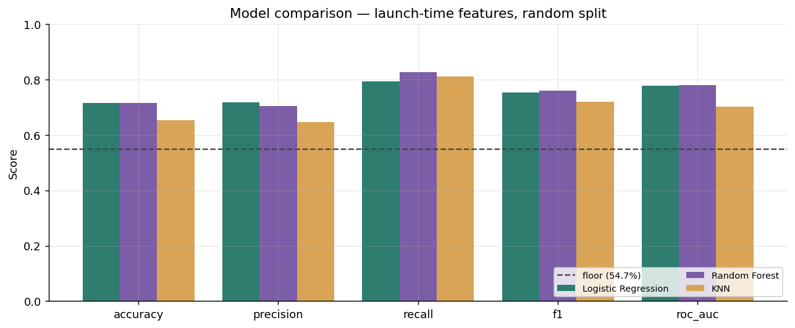
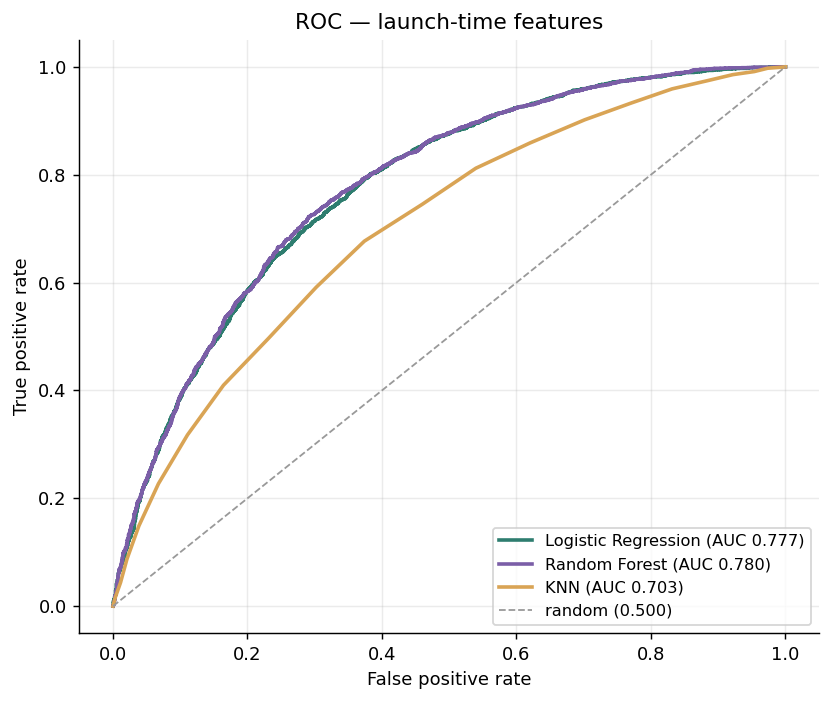
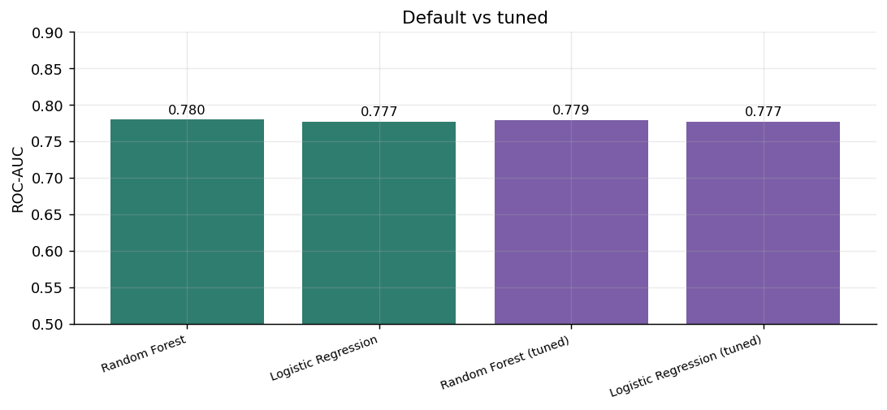
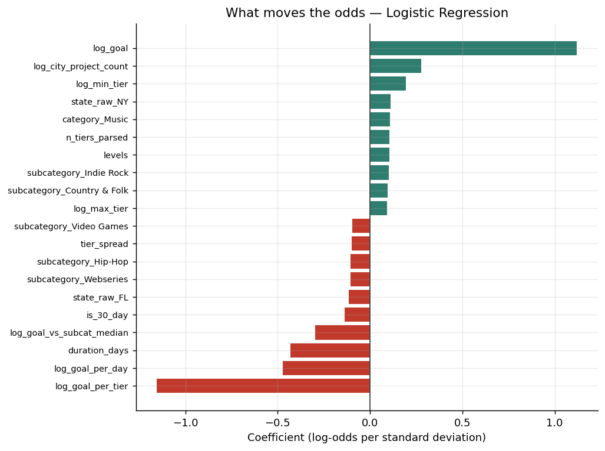
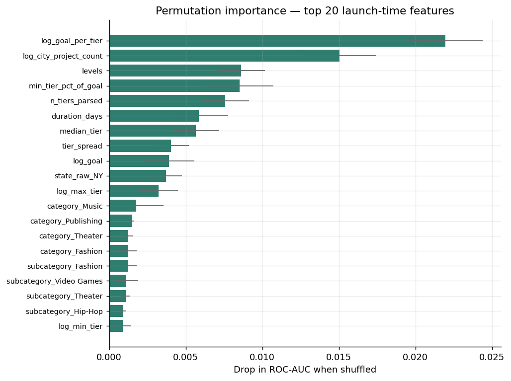

# Kickstarter Crowdfunding Recommendation Engine

Predicting whether a Kickstarter campaign will succeed or fail from
information available **at launch**, and turning the drivers of success into
actionable advice for creators.

Break Through Tech AI Studio — Fall 2026
Challenge Advisor: Neha Panchal · AI Studio Coach: Darshan Ugale

> **Status:** Milestone 3 (Machine Learning / Modeling) complete — feature set
> locked, three classifiers built and compared, tuned, and a final model
> selected (Tasks 1–5). September's data preparation and EDA is also complete.
> Next: the recommendation prototype.

---

## Team Members

| Name             | GitHub Handle | Contribution                                                             |
|------------------|---------------|--------------------------------------------------------------------------|
| James Lu         | @jameslu06    | Data exploration, visualization, overall project coordination            |
| Yero Barry       | @Ybarry2      | Python development, AI/ML, prompt engineering, and team communication    |
| Menwe Okafor     | @menwe2310    | Python development, AI model development, and data analysis              |

---

## September Milestone (Milestone 1: Data Preparation & 2: Exploratory Data Analysis) — Tasks

| # | Task | Target | Status | Evidence |
|---|------|--------|--------|----------|
| 1 | Download and inspect the dataset | 9/9 | Done | `notebooks/01_inspection.ipynb` |
| 2 | Filter and clean the dataset | 9/13 | Done | `notebooks/02_cleaning.ipynb` |
| 3 | Prepare features for analysis | 9/17 | Done | `notebooks/03_features.ipynb` |
| 4 | Perform exploratory data analysis | 9/24 | Done | `notebooks/04_eda.ipynb` |
| 5 | Create visualizations and summarize findings | 9/30 | Done | `notebooks/04_eda.ipynb`, `reports/` |

## October Milestone (Milestone 3: Machine Learning - Modeling) — Tasks

| # | Task | Assignee(s) | Status | Evidence |
|---|------|-------------|--------|----------|
| 1 | Prepare data and lock the feature set | Done | `notebooks/05_prepare_and_split.ipynb`, `reports/m3_leakage_register.csv`, `reports/m3_split_summary.csv` |
| 2 | Build baseline and classification models | Yero (Logistic Regression), James (Random Forest), Menwe (KNN) | Done | `notebooks/06a_logistic_regression.ipynb`, `06b_random_forest.ipynb`, `06c_knn.ipynb`, `reports/m3_task7_*.csv` |
| 3 | Compare model performance | Done | `notebooks/07_comparison.ipynb`, `reports/m3_task8_comparison.csv`, `reports/figures/m3_model_comparison.png` |
| 4 | Perform feature selection and tune models | Done | `notebooks/08_tuning.ipynb`, `reports/m3_tuned_config.json`, `reports/m3_class_balancing.csv` |
| 5 | Analyze interpretability and select final model  | Done | `notebooks/09_final_model.ipynb`, `reports/m3_model_card.json`, `reports/m3_coefficients.csv` |

---

## Project Highlights

- Built a reproducible preprocessing pipeline reducing the raw 45,957-row
  scrape to a **38,378-row** modelling table, with every transformation
  logged and row-counted.
- Found and fixed an **HTML-entity encoding bug** that silently split the
  platform's largest category (`Film &amp; Video` vs `Film & Video`) into
  two, and the same class of bug in the location column (`MT` vs `Mt`).
- **Validated against the original project's recipe** to within one row
  (38,492 vs their published 38,491) before making any deliberate change.
- **Resolved the `updates` leakage risk** by excluding it from the primary
  model, and measured exactly what that exclusion costs rather than asserting it.
- Built **Logistic Regression, Random Forest and KNN** on identical splits and
  features; all three beat the 54.7% majority-class floor, and the two best sit
  about **17 points above it**.
- Selected **Logistic Regression (tuned)** as the final model: statistically
  level with Random Forest (ROC-AUC gap 0.002) but with directly readable
  coefficients, which the recommendation prototype needs.

---

## Setup and Installation

```bash
git clone https://github.com/<your-org>/Global-Financial-Firm-1B-kickstarter-crowdfunding-recommendation-engine.git
cd Global-Financial-Firm-1B-kickstarter-crowdfunding-recommendation-engine

python -m venv .venv
source .venv/bin/activate        # Windows: .venv\Scripts\activate
pip install -r requirements.txt

jupyter lab
```

The raw dataset zip is committed to `data/`, so no Kaggle login is needed.
Run the notebooks **in order**. `05_prepare_and_split` rebuilds the cleaned
table from the raw file itself and writes the train/test splits that
`06a`–`06c` read. `07` reads the per-model result CSVs those notebooks write,
`08` reads the splits and writes the tuned configuration, and `09` reads that
configuration to rebuild the finalists. Each notebook also runs on Colab (it
clones the repo automatically).

### Repository layout

```
src/loading.py       Raw load: encoding handling, column normalisation
src/cleaning.py      Filter, clean and validate, with an auditable step log
src/features.py      Feature engineering, feature sets and leakage register
src/modeling.py      Random and chronological splits, model constructors
src/evaluation.py    One shared evaluate() so every model reports identically
notebooks/           One notebook per task (01-04 September, 05-09 modeling)
data/                Raw zip (committed) + derived parquet (gitignored)
reports/             Step log, EDA tables, model results, model card
reports/figures/     Generated charts
```

Cleaning, feature and evaluation logic lives in `src/`, not in the notebooks,
so there is exactly one definition of "the modelling table" and one definition
of each metric. Three people built three models in parallel and their results
concatenate into one table without reconciliation.

---

## Project Overview

Crowdfunding is unforgiving: Kickstarter is all-or-nothing, so a campaign
raising 99% of its goal returns every dollar and the creator gets nothing.
**Roughly 45% of resolved campaigns in this dataset failed.** A creator has
to make several irreversible decisions — how much to ask for, how long to
run, how to structure rewards — before any feedback exists.

That sets the requirement: the model has to work from information available
**at launch**, or it cannot inform those decisions.

---

## Data Exploration

**Source:** [Kickstarter dataset on Kaggle](https://www.kaggle.com/parienza/kickstarter)
**Raw size:** 45,957 campaigns × 17 columns
**Coverage:** April 2009 – May 2012
**Final table:** 38,378 campaigns × 56 features — 13 categories,
49 subcategories, 51 states, 3,153 cities

### Data quality issues found

| # | Issue | Resolution |
|---|---|---|
| 1 | File is neither UTF-8 nor cp1252 (bytes `0x92`, `0x8f`) | Load with `encoding="latin-1"` |
| 2 | `Film &amp; Video` and `Film & Video` are separate categories | `html.unescape()` **before** grouping — 14 to 13 categories, 51 to 49 subcategories |
| 3 | Montana appears as both `MT` and `Mt` | Case-insensitive state whitelist |
| 4 | 142 duplicated `project_id` values | Deduplicate on the platform's own primary key |
| 5 | Max goal is $21,474,836.47 = 2³¹−1 cents | Integer overflow artefact; row dropped |
| 6 | `funded_date` is the campaign **end** date | Recovered `launch_date = funded_date − duration` |
| 7 | `reward_levels` has commas *inside* amounts (`$1,000`) | Comma-aware regex; **100%** agreement with the scraper's own `levels` column |
| 8 | Nulls in `location`, `reward_levels`, `pledged` | `dropna` on modelling columns only |

### Cleaning funnel



45,957 to 38,378 rows. Full audit trail in `reports/cleaning_step_log.csv`.

### Validation

- **Benchmark recipe reproduced.** Applying the original project's filters
  yields 38,492 rows against their stated 38,491 — a single row apart.
  Confirming this *before* deviating means our changes are distinguishable
  from our mistakes.
- **Labels are trustworthy.** `status` and `funded_percentage` agree on
  99.98% of rows; only 3 contradict, all scrape-timing artefacts.
- **Three documented deviations** cost 114 rows (0.30%). The important one is
  deduplication — the original kept 113 duplicate scrapes, which would place
  the same campaign in both train and test.

### EDA findings

Class balance is 54.7% successful, so **any model must beat 54.7% accuracy**
to be doing better than always guessing "successful."

| Rank | Factor | Effect on success | Known at launch? |
|---|---|---|---|
| 1 | **Updates** | 20% to 92% from 0 to 13+ updates | **No** |
| 2 | **Goal** | Monotonic decline across all 10 deciles | Yes |
| 3 | **Subcategory** | Widest categorical spread, 29% to 77% | Yes |
| 4 | **Reward tiers** | More tiers and a low entry price both help | Yes |
| 5 | **Duration** | Longer is *worse*; the 30-day default wins | Yes |
| 6 | **Category** | Real effect, survives controlling for goal | Yes |
| 7 | **Location** | Modest — a few points between best/worst states | Yes |

**Median values by outcome:**

| | Successful | Failed |
|---|---|---|
| Goal | $3,000 | $5,000 |
| Duration | 31.0 days | 35.0 days |
| Reward tiers | 8 | 7 |
| Updates | 5 | 0 |



**Goal is the strongest launch-time signal**, and the shape matters as much
as the direction: the decline is steep below ~$20k and flattens above it,
which is what makes goal-setting advice actionable.



**We controlled for the obvious confound.** Dance and Theater post excellent
success rates — but they also ask for far less money (Spearman −0.68 between
a category's median goal and its success rate). Comparing categories *within*
goal quartiles shows the ordering largely survives, so both effects are real
and neither explains the other away.

**Duration runs against intuition:** longer campaigns do *worse*. A long
window signals low confidence; momentum matters more than time.



Features are ranked **before** any model is fitted — rank correlation for
numeric features, success-rate spread for categorical ones — so the ranking
reflects the data rather than one algorithm's inductive bias.

---

## Milestone 3 — Modeling

### Task 1 · Feature set and leakage decision



`updates` counts creator posts made *during* a campaign, and it is the
strongest signal in the dataset — 20% success at zero updates, 92% at
thirteen or more. It cannot be used in a launch-time model: it is zero on
launch day for every campaign, and the causation runs at least partly
backwards (a campaign visibly funding well attracts a creator who keeps
posting, while a stalling one goes quiet).

**Decision:** `updates` is excluded from the primary feature set. Both sets
were carried forward so the cost could be measured:

| Feature set | Contents | Role |
|---|---|---|
| `launch_only` (**primary**) | 22 numeric launch-time features + category, subcategory, state (137 columns after one-hot encoding) | Pre-launch predictor |
| `plus_campaign` | `launch_only` + `updates` | Labelled *mid-campaign* model only; never presented as a pre-launch predictor |

- **Target:** `success` = 1 if `status == "successful"`, verified against
  funding percentage.
- **Excluded outcome columns:** `pledged`, `funded_percentage`, `backers`,
  `comments` (plus identifiers and raw strings; full list with reasons in
  `reports/m3_leakage_register.csv`).
- **Encoding:** one-hot for category, subcategory and state; frequency
  encoding for city. Logistic Regression and KNN are wrapped in a
  `StandardScaler` pipeline so the scaler is fitted on training data only.
- **Splits:** random stratified 80/20 (30,702 train / 7,676 test) **and**
  chronological (train on earlier campaigns, test on later ones, cut at
  2012-02-11).
- **No test information in training:** the two data-derived features (city
  frequency and goal relative to the subcategory median) are fitted on the
  training split and applied to the test split.

> **Open item for the Challenge Advisor:** the published benchmark for this
> dataset (80.2% accuracy, F1 0.834) was produced with `updates` included.
> The exclusion is recorded as pending advisor confirmation.

### Task 2 · Models

All three models use the same features and splits and report through the same
`evaluate()` function. Primary configuration: `launch_only`, random split.

| Model | Built by | Accuracy | vs. 54.7% floor |
|---|---|---|---|
| Logistic Regression (baseline) | Yero | 71.6% | +16.9 pts |
| Random Forest | James | 71.5% | +16.8 pts |
| KNN | Menwe | 65.3% | +10.6 pts |

### Task 3 · Model comparison



| Model | Accuracy | Precision | Recall | F1 | ROC-AUC |
|---|---|---|---|---|---|
| Random Forest | 0.7153 | 0.7041 | 0.8277 | 0.7609 | 0.7798 |
| Logistic Regression | 0.7160 | 0.7175 | 0.7936 | 0.7536 | 0.7770 |
| KNN | 0.6528 | 0.6453 | 0.8119 | 0.7191 | 0.7026 |
| Majority-class floor | 0.5473 | 0.5473 | 1.0000 | 0.7074 | 0.5000 |



- **Random Forest and Logistic Regression are effectively tied.** They share
  accuracy to the first decimal and differ by 0.003 in ROC-AUC. Random Forest
  catches more successes (recall 0.83 vs 0.79); Logistic Regression is more
  precise (0.72 vs 0.70).
- **KNN trails by about 6 points.** This was expected: after one-hot encoding
  there are 137 columns, distances concentrate in high dimensions, and
  "nearest" stops meaning "similar."
- **All models lean towards predicting "success."** Recall is high and
  precision modest, so most errors are false positives — creators told to
  launch whose campaigns then fail.
- **The floor is a trap on F1.** Always guessing "successful" scores 0.71 F1,
  which is why accuracy, ROC-AUC and the floor are reported together.

**What excluding `updates` costs** (random split, accuracy):

| Model | `launch_only` | `plus_campaign` | Cost of exclusion |
|---|---|---|---|
| Logistic Regression | 71.6% | 81.6% | 10.0 pts |
| Random Forest | 71.5% | 81.8% | 10.3 pts |
| KNN | 65.3% | 68.6% | 3.3 pts |

With `updates`, Random Forest reaches 81.8% accuracy and F1 0.838, matching
the published benchmark (80.2% / 0.834). That confirms the gap to the
benchmark is the leakage variable, not the modelling. This is a mid-campaign
result and is not our headline number.

**Random vs. chronological split:** the two are close (Logistic Regression
71.6% vs 71.8%, Random Forest 71.5% vs 72.0%, KNN 65.3% vs 65.7%), so the
launch-time relationships look stable across 2009–2012 rather than something
the models memorised from one era.

### Task 4 · Feature selection and tuning



| Experiment | Result |
|---|---|
| **Class balancing** (`class_weight="balanced"`) | No meaningful gain. Accuracy within 0.6 pts; it trades recall for precision (Logistic Regression recall 0.79 to 0.73, precision 0.72 to 0.74) |
| **Feature pruning** (permutation importance, 137 to 40 features) | Random Forest ROC-AUC 0.7788 to 0.7764. 61 features had zero or negative importance. The pruned model is nearly as good with a third of the features |
| **Hyperparameter tuning** (`RandomizedSearchCV`, 3-fold CV on training data only, scored on ROC-AUC) | CV ROC-AUC 0.7687 (RF) and 0.7690 (LR). Held-out test results unchanged from the defaults |

Engineered features worth noting: `log_goal_per_tier`, `log_goal_per_day`,
`log_goal_vs_subcat_median`, `min_tier_pct_of_goal`, `tier_spread` and the
title features. Tuned settings are saved in `reports/m3_tuned_config.json`.

**The headline finding of this task:** tuning, pruning and balancing each move
results by well under a point. The binding constraint is the information in
the data, not the model or its settings.

### Task 5 · Interpretability and final model

**What drives predictions.** Standardised Logistic Regression coefficients
(change in log-odds of success per standard deviation):



| Raises success | Lowers success |
|---|---|
| `log_goal` (+1.12) | `log_goal_per_tier` (−1.15) |
| `log_city_project_count` (+0.28) | `log_goal_per_day` (−0.47) |
| `log_min_tier` (+0.19) | `duration_days` (−0.43) |
| Category Music, subcategory Indie Rock | `log_goal_vs_subcat_median` (−0.30) |
| State NY | `is_30_day` (−0.14), state FL |

Goal-related features dominate, and several are different views of the same
quantity (the signs on `log_goal` and `log_goal_per_tier` offset), so read
those individual coefficients as a group rather than one at a time. The
practical reading is: **ask for less per reward tier, keep the campaign
shorter, and offer a low entry price.**

Permutation importance on held-out data (Random Forest) agrees on the top
tier: `log_goal_per_tier`, `log_city_project_count`, `levels`,
`min_tier_pct_of_goal`, `n_tiers_parsed` and `duration_days`.



**Final model: Logistic Regression (tuned).** The two finalists differ by
0.002 ROC-AUC. Our decision rule was that a gap under about 0.01 will not
change any recommendation the prototype makes, so the model that can explain
itself wins.

| Criterion | Random Forest (tuned) | Logistic Regression (tuned) |
|---|---|---|
| ROC-AUC | 0.7792 | 0.7770 |
| F1 | 0.7608 | 0.7536 |
| Explains advice to a creator | Indirect (needs SHAP or permutation) | Direct (coefficients) |

**Final model performance** (launch-time features, random split, 7,676 test campaigns):

| Accuracy | Precision | Recall | F1 | ROC-AUC |
|---|---|---|---|---|
| 0.716 | 0.718 | 0.794 | 0.754 | 0.777 |

**Strengths**
- Beats the 54.7% floor by about 17 points using only information known at launch.
- Coefficients convert directly into creator advice.
- Performance holds on the chronological split (accuracy 71.8%, ROC-AUC 0.794), so it is not flattered by a random split.

**Limitations**
- **Launch-time ceiling.** The scrape has no campaign description, video,
  image count, creator history or social following. Getting past ~72%
  probably needs that signal, not a better algorithm.
- **Platform drift.** Trained on 2009–2012 Kickstarter (including the June
  2011 change capping campaigns at 60 days); not validated for today's platform.
- **US campaigns only.** No claim is made about international campaigns.
- **Error profile.** The Random Forest finalist produced 1,469 false
  positives against 720 false negatives on the test set. False positives
  skewed to low-goal campaigns (median $2,500), and false negatives to higher
  goals (median $7,250), so the model likely over-trusts goal size at the
  extremes.
- **Calibration checked on Random Forest only.** Its predicted probabilities
  were compressed towards the middle (e.g. 0.15 predicted vs 0.11 observed in
  the lowest decile, 0.83 vs 0.87 in the highest). The ranking is sound, but
  the Logistic Regression's probabilities should be checked before they are
  shown to a creator as a percentage.
- **Correlated features.** Goal-derived and reward-tier features are
  collinear, so individual coefficients are unstable even where the model is not.
- **Threshold is a choice.** Every metric above uses a 0.5 cutoff. Moving it
  to 0.46 lifts Random Forest F1 from 0.761 to 0.767; which error is worse
  (false encouragement or false discouragement) is a product decision.

The full model card is in `reports/m3_model_card.json`.

---

## Next Steps — Recommendation Prototype

1. Check the calibration of the final Logistic Regression and decide how a
   probability is shown to a creator.
2. Choose the decision threshold, based on which error is worse for creators.
3. Turn the coefficients into "what-if" advice (goal per tier, duration,
   entry price) and test it on held-out campaigns.
4. Confirm the `updates` exclusion with the Challenge Advisor.
5. Consider SHAP if the team moves to Random Forest.

Closing the gap on a launch-time model likely requires signal this scrape
does not contain: campaign description text, video presence, image count,
creator history, and social following.

---

## License

This project is licensed under the MIT License.

---

## References

- [Kickstarter dataset on Kaggle](https://www.kaggle.com/parienza/kickstarter)
- [scikit-learn documentation](https://scikit-learn.org/stable/)

---

## Acknowledgements

Thanks to Challenge Advisor Neha Panchal and AI Studio Coach Darshan Ugale
for guidance throughout this project.
